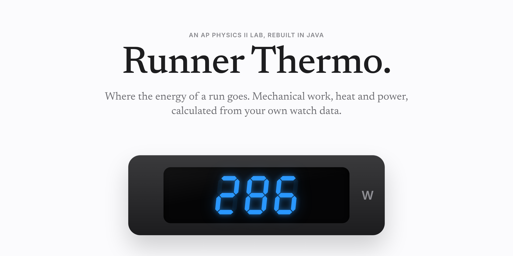
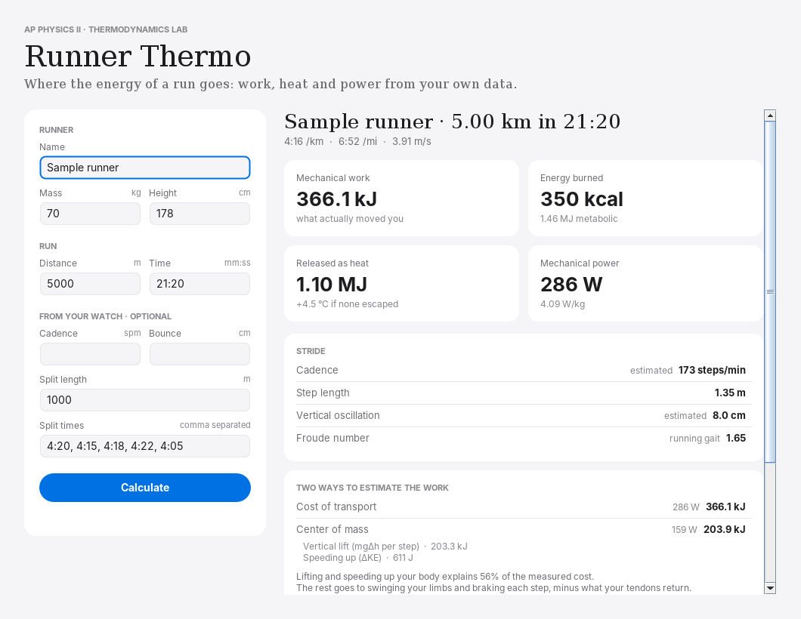

<p align="center">
  <picture>
    <source media="(prefers-color-scheme: dark)" srcset="assets/readme/hero-dark.png">
    
  </picture>
</p>

<p align="center">
  <a href="#the-idea">The idea</a> &nbsp;·&nbsp;
  <a href="#the-physics">The physics</a> &nbsp;·&nbsp;
  <a href="#run-it">Run it</a> &nbsp;·&nbsp;
  <a href="#how-its-built">How it's built</a>
</p>

<br>

## The idea

In AP Physics II we measured the mechanical work and power of runners from their mass and a timed run. I run, so I wanted to point the same physics at my own watch data and see where the energy actually goes.

The short answer: most of it becomes heat. Muscles are only about 25% efficient, so for every joule that moves you forward, three more warm you up. Run a 5K and you release over a megajoule of heat, enough to raise your body temperature more than 4 °C if none of it escaped.

Runner Thermo turns that lab into a small Java application with a terminal version and a Mac app, both built on the same physics engine.

> *Coding reveals truth*  
> *like the ancient gift of fire,*  
> *nature found in text.*

<br>

<p align="center">
  <picture>
    <source media="(prefers-color-scheme: dark)" srcset="assets/readme/app-dark.png">
    
  </picture>
</p>

<br>

## The physics

The app estimates the work two independent ways and shows both, because the gap between them is the interesting part.

**1. Cost of transport (top-down).** Exercise physiologists have measured that level running costs about 1 kcal per kilogram per kilometer, almost regardless of speed (Margaria et al., 1963).

$$E_{\text{metabolic}} = C \cdot m \cdot d, \qquad C \approx 4.18\ \text{J/(kg·m)}$$

$$W_{\text{mechanical}} = \eta \cdot E_{\text{metabolic}}, \qquad \eta \approx 0.25$$

**2. Center of mass (bottom-up).** Treat the runner as a point mass and add up the work Newton would count: lifting the body on every step, and speeding up.

$$W = \underbrace{N_{\text{steps}} \cdot mg\Delta h}_{\text{vertical lift}} + \underbrace{\sum \tfrac{1}{2}m\left(v_{i}^{2} - v_{i-1}^{2}\right)^{+}}_{\text{speeding up between splits}}$$

With typical values, the center-of-mass model explains about half of the measured cost. The rest goes to swinging the arms and legs and to braking on every footstrike, partly offset by elastic energy the Achilles tendon stores and returns.

**Thermodynamics.** By the first law, whatever metabolic energy doesn't become work becomes heat:

$$Q = E_{\text{metabolic}} - W, \qquad \Delta T_{\text{no cooling}} = \frac{Q}{m \, c_{\text{body}}}, \quad c_{\text{body}} \approx 3470\ \text{J/(kg·K)}$$

**Stride.** Step length comes from speed and cadence ($L = v / f$). The Froude number $Fr = v^2 / gL_{\text{leg}}$ compares speed to leg length; above about 0.5, people switch from walking to running.

Every constant and assumption lives in [`PhysicsConstants.java`](src/runnersim/physics/PhysicsConstants.java), so each one is easy to find and question.

<br>

## Run it

Needs Java 17 or newer (`java -version` to check).

```bash
./build.sh test   # physics tests, checked against hand calculations
./build.sh cli    # terminal version: type in your biometrics, run and splits
./build.sh gui    # window version
./build.sh app    # package Runner Thermo.app and install it in /Applications
```

Have a watch? Enter your cadence, vertical oscillation and lap splits for better numbers. Anything you skip is estimated and labeled that way.

<br>

## How it's built

```
src/runnersim/
├── App.java                     Entry point: window by default, --cli for the terminal
├── model/                       What a run is
│   ├── Runner.java              Mass, height, leg length
│   ├── Run.java                 Distance, time, splits, watch metrics
│   └── Split.java
├── physics/                     The engine, shared by both interfaces
│   ├── WorkModel.java           Interface: one physical model of work
│   ├── CostOfTransportModel.java
│   ├── CenterOfMassModel.java
│   ├── Gait.java                Cadence, step length, Froude number
│   ├── RunAnalyzer.java         Runs every model, builds the report
│   ├── RunReport.java
│   ├── EnergyBreakdown.java
│   ├── PhysicsConstants.java
│   └── Units.java
├── cli/                         Terminal interface (Scanner)
└── gui/                         Mac app interface (Swing)
test/runnersim/PhysicsTests.java
```

The physics never knows which interface is calling it. Adding a new model, say one for running uphill, means writing one class that implements `WorkModel` and adding it to `RunAnalyzer`.

<br>

## Roadmap

- [x] Two work models with a side-by-side comparison
- [x] Terminal and Mac app interfaces on one engine
- [ ] Import runs from a GPX or FIT file instead of typing splits
- [ ] Hills: add $mgh$ for elevation gain
- [ ] Wind and air resistance: $\tfrac{1}{2}\rho C_d A v^2$
- [ ] Compare my numbers with a treadmill test

<br>

## License

[MIT](LICENSE)
